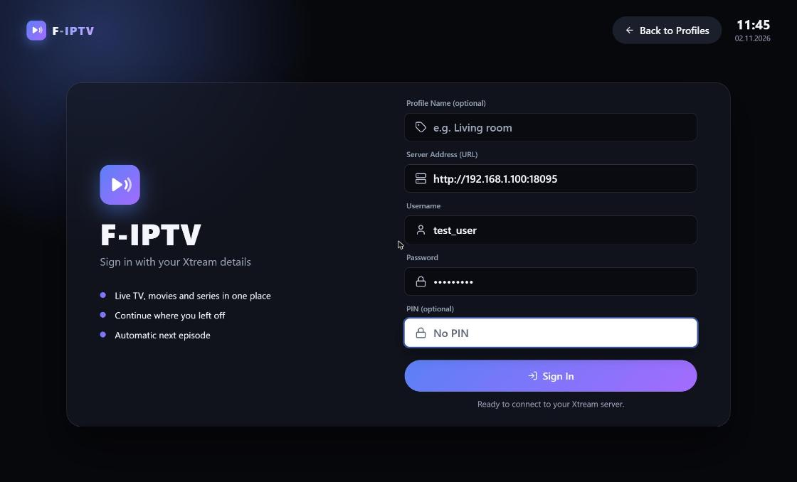
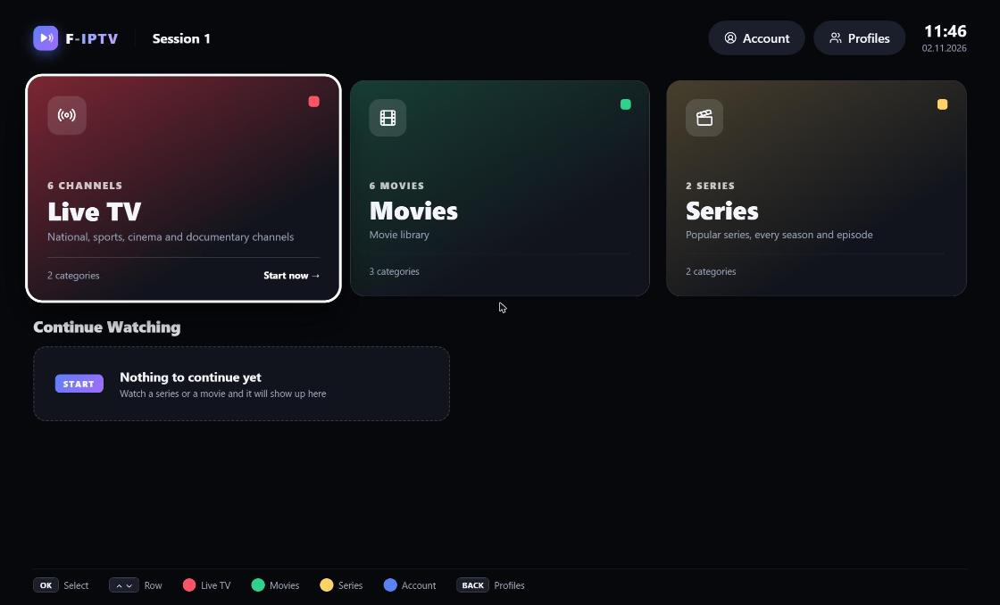
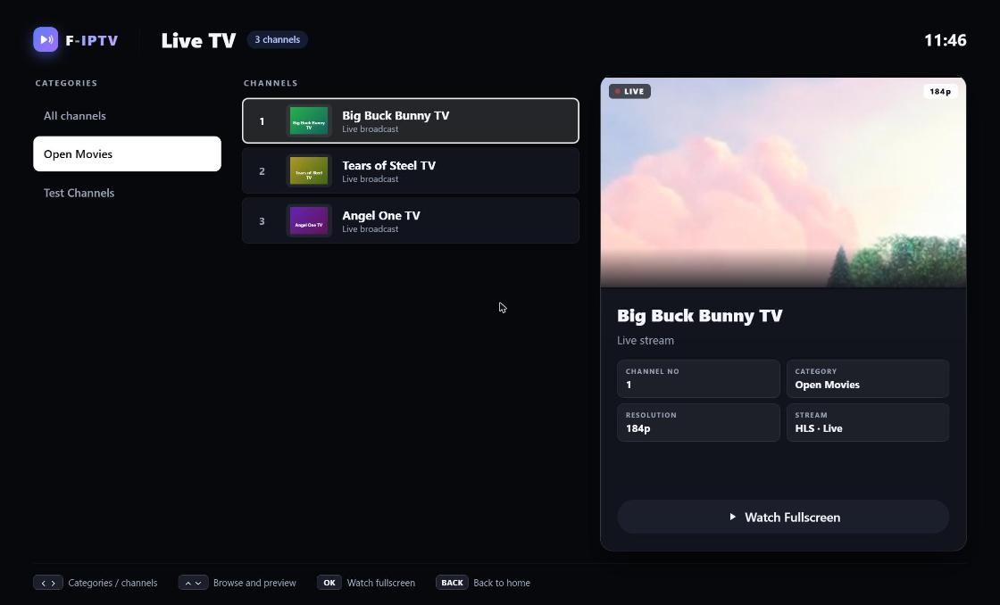
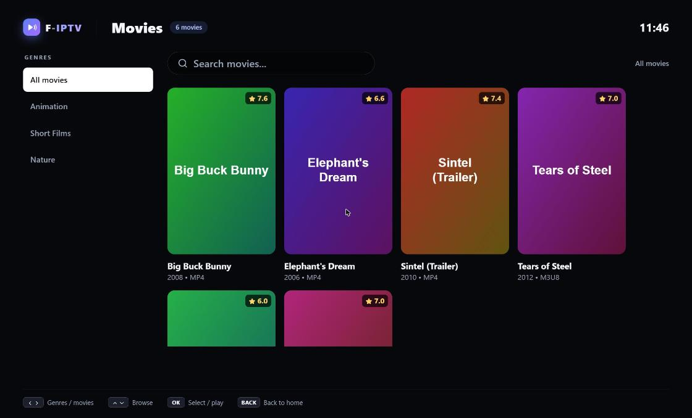
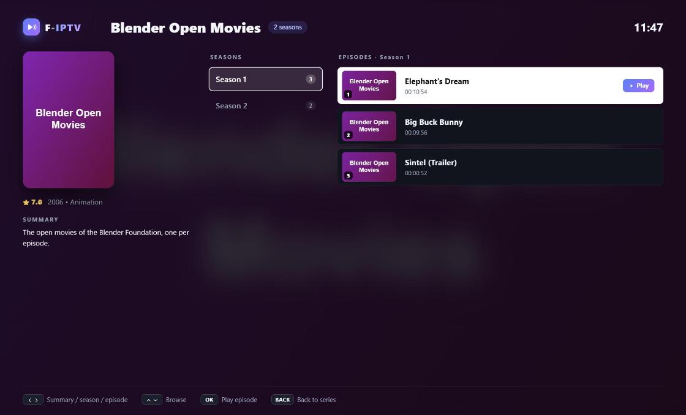

# F-IPTV

An open-source TV app for **Xtream-compatible IPTV services**. It plays the subscription *you*
add (live TV, movies and series) in TV browsers (Tizen, webOS, VIDAA, Android TV) and desktop
browsers, and it is an installable PWA.

> **Early stage.** F-IPTV is new and not battle-tested. It has no automated tests of its own yet and has only
> been tried on a few devices. Expect rough edges and changes; fork it if you want to build on it.

There is no hosted demo: run it yourself (see [Getting started](#getting-started)) or host the built `dist/` folder
wherever you like. See [HTTP and HTTPS](#http-and-https) below for which address to serve it from.

## HTTP and HTTPS

Browsers block a page served over **HTTPS** from calling an **HTTP** address (mixed content), and an installed PWA
follows the same rule. So the address F-IPTV is opened from decides which servers it can reach:

| F-IPTV is opened from | Xtream server is HTTP (`http://...`) | Xtream server is HTTPS (`https://...`) |
| --- | --- | --- |
| An **HTTPS** address (a static host with a certificate) | Blocked by the browser | Works, if the server allows cross-origin requests (CORS) |
| An **HTTP** address (your own computer or server, for example `http://localhost:3000` or `http://<computer-ip>:3000`) | **Works** | Works |

Recent desktop versions of Chrome also restrict a public web page from calling servers on your local network
(for example `http://192.168.1.10:8080`); they may block the request or ask for permission. TV browsers do not have this
restriction. If you run into it on a desktop, run F-IPTV on your own computer as described in
[Getting started](#getting-started).

You can also serve the built `dist/` folder from your own `http://` address. An HTTP page cannot be installed as a PWA.

## About content (please read)

F-IPTV is a **player**, not a content source.

- It ships **no** channels, playlists, movies, series or streams, and it hosts, indexes or redistributes nothing.
- It does **not** support, promote or help find illegal or unlicensed streams. Use it only with services
  and content you have the legal right to watch (your own subscription, free-to-air or openly licensed
  streams, or your own media).
- You are responsible for the content you play with it. The authors take no responsibility for how it is used.

## Features

- **Profiles.** A profile picker opens first, like a streaming service: add up to 4 Xtream accounts, name
  them, edit or forget them. Each profile keeps its own continue-watching data.
- **Optional PIN per profile.** A profile with a PIN asks for it before it opens or is edited (never before it
  is forgotten) and hides its server address on the picker.
- **Live TV** with categories, a channel list and a live preview, **Movies**, and **Series** with seasons and
  episodes.
- **Continue watching** for movies and series, on the home screen and in their own categories, with check-and-delete editing.
- **Player** with HLS and progressive streams, seeking, subtitles, audio tracks, quality, previous/next channel,
  next episode with an "up next" card, back to live and aspect ratio.
- **Two languages**, English and Turkish. The language follows the device (English if unknown) and can be changed
  from the profile picker.
- **Made for the remote.** Everything is reachable with the D-pad, colour keys jump to Live TV, Movies, Series and
  the account, and the on-screen keyboard has a phone-style shift key and a caret.
- **PWA.** Manifest, icons and a service worker; installable from a secure (HTTPS) address.

## Screenshots

Taken against a local Xtream test server that serves openly licensed sample videos (the Blender open
movies and public HLS test streams). F-IPTV itself contains no content.

| | |
| --- | --- |
|  |  |
|  |  |
|  |  |

## Built on zapkit-tv

The UI, the focus system, the router and the video player come from
[**zapkit-tv**](https://github.com/cakmakfatih/zapkit-tv), a small React-like UI library for TV web apps that
is also open source ([npm package `zapkit-tv`](https://www.npmjs.com/package/zapkit-tv)). F-IPTV is the example app
for it. It is installed like any other dependency:

```bash
npm install zapkit-tv
```

```tsx
import { h, render, createRouter, RouterView, focus, installScaling } from 'zapkit-tv';
import { setHlsConstructor } from 'zapkit-tv/player';
import 'zapkit-tv/styles.css';
```

What the app uses from it:

| zapkit-tv part | Where F-IPTV uses it |
| --- | --- |
| `createRouter`, `RouterView` | Screen stack with focus restored on Back (`src/main.tsx`) |
| Focus manager, `FocusGroup` | D-pad navigation on every screen |
| `VirtualList` | The poster grids and channel lists, however long the catalogue |
| `VideoPlayer` and slots | The player; "next episode", "go live", aspect ratio and close are added through `extraControls` |
| `OnScreenKeyboard` | Text entry for login, search and the PIN |
| Overlays and toasts | Dialogs and messages |

## Why it is light on TVs

- **No virtual DOM.** zapkit-tv renders with Google's incremental-dom, which patches only what changed in
  the real DOM. Memory use and garbage collection stay low on weak TV chipsets.
- **Small windows of DOM.** A catalogue can hold thousands of titles; `VirtualList` keeps only the part around the focus
  on screen and scrolls it with a CSS transform.
- **Small download.** The application script is about 73 kB gzipped. The video engine (hls.js) is a separate
  file that loads only when needed.
- **Old-browser build.** The build targets Chrome 69, so it also runs on older TV browsers.
- **Light on the network.** Lists are fetched once and cached for about 12 minutes, and the app shell is cached by the
  service worker so the UI opens quickly.

## Getting started

You need Node.js 18 or newer.

```bash
git clone https://github.com/cakmakfatih/f-iptv.git
cd f-iptv
npm install
npm run dev          # development server on http://0.0.0.0:3000
```

Other commands:

```bash
npm run build        # type-check and build to dist/
npm run preview      # serve the production build on http://0.0.0.0:3000
npm run typecheck
```

Open `http://<computer-ip>:3000` in the TV browser, add a profile with your server address,
username and password, and press Sign in. Use the production build (`preview`) on a TV: the dev server is not
transpiled for old engines.

To try it without a provider, point it at any Xtream-compatible test server that serves openly licensed content, the way the screenshots above were made.

### Installing as a PWA

The manifest, icons and service worker are included. Browsers offer installation and register the service worker only
on a **secure context** (`https://` or `localhost`). Served over plain `http` on a LAN address, the app works as a normal
web page (this is how it is usually used on a TV) but cannot be installed. To make it installable, serve `dist/` over HTTPS.
A page served over HTTPS cannot call an `http://` Xtream server, see [HTTP and HTTPS](#http-and-https).

### Hosting it yourself

`dist/` is a static site. The repository includes a Cloudflare configuration (`wrangler.jsonc`, `public/_headers`):

```bash
npx wrangler login
npm run deploy       # build, then publish to Cloudflare Workers (set your own domain in wrangler.jsonc)
```

Any static host works.

## Good to know

- The app talks to your Xtream server straight from the browser. The server (and the network the device is on) must
  be reachable from that device; if the TV uses a filtering DNS service, allow your server's domain there.
- Channel logos come from many third-party sites. When the app is served with `npm run dev` or `npm run preview`, a small
  server-side helper (`image-proxy.ts`: public addresses and image responses only) fetches them for the TV. Served from a
  static host, the browser loads them directly.
- Passwords and PINs of saved profiles are stored in the browser's `localStorage` on the device. A PIN is a
  convenience lock, not strong security.

## Project layout

| Path | Content |
| --- | --- |
| `src/screens` | Profiles, Login (add/edit), Home, Live, Movies, Series, SeriesDetail, Watch |
| `src/components` | Shared UI, the player parts that belong to this app, list editing, the language switch, icons |
| `src/services` | Xtream client and profiles (`api.ts`), continue-watching store (`history.ts`), stream sources (`media.ts`), formatting |
| `src/i18n` | `t()`, language detection, `en.ts` (source of the keys) and `tr.ts` |
| `public` | Manifest, service worker, icons and cache headers |
| `image-proxy.ts` | Vite plugin that fetches channel logos for the TV |

## Settings you may want to change

- **Poster columns:** `COLUMNS` in `src/components/grid.ts` (4 big cards or 6 smaller ones per row).
- **Profile limit:** `MAX_PROFILES` in `src/services/api.ts`.
- **Add a language:** add a table with the same keys as `en.ts` and register it in `src/i18n/index.ts`.

## License

[Apache License 2.0](LICENSE).
